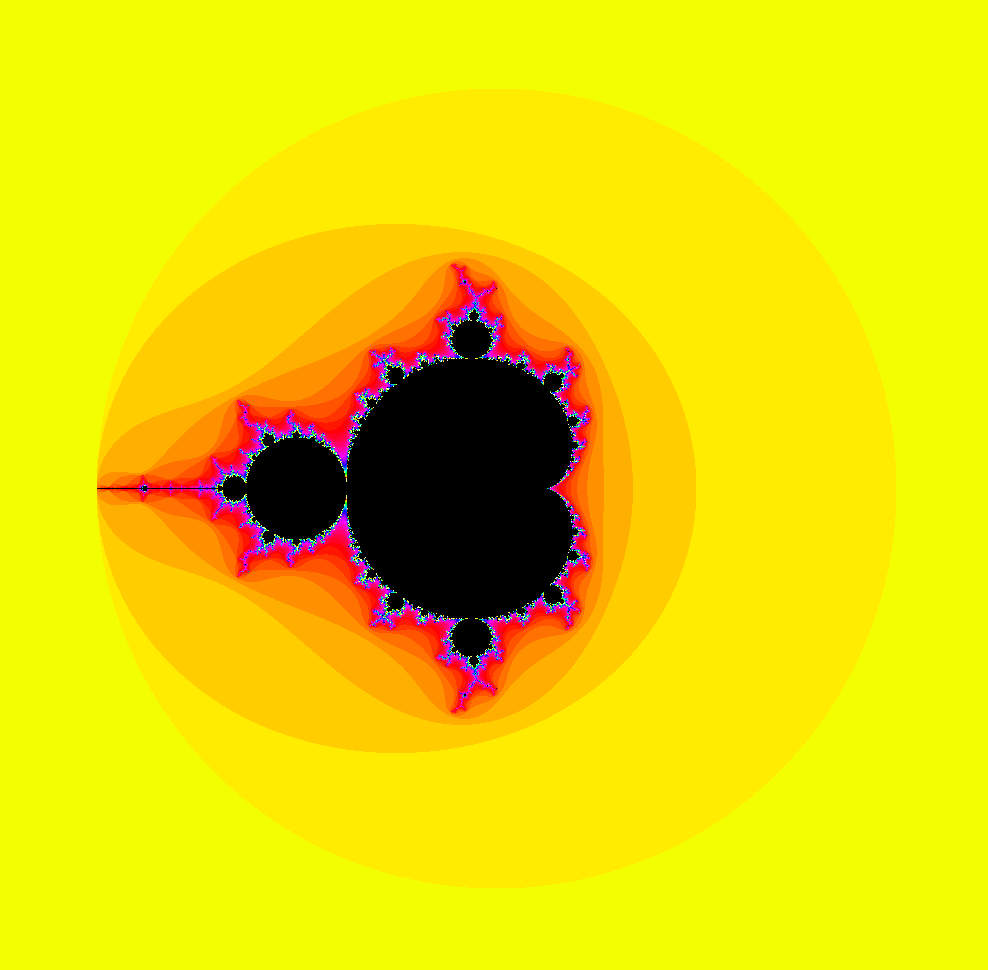
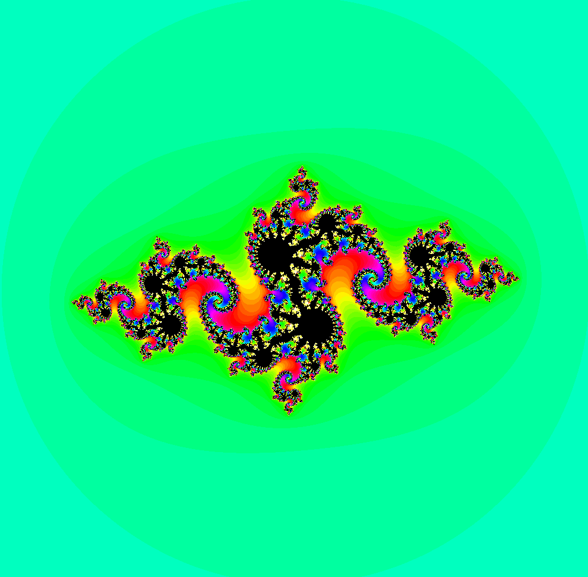
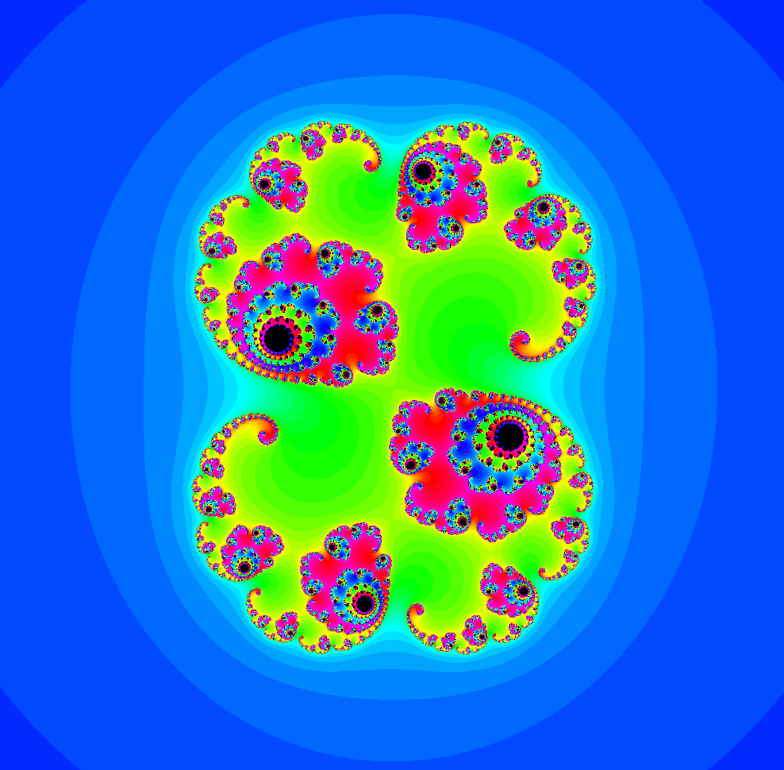
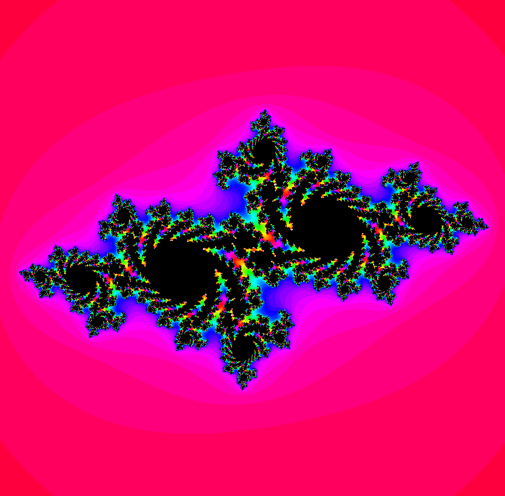
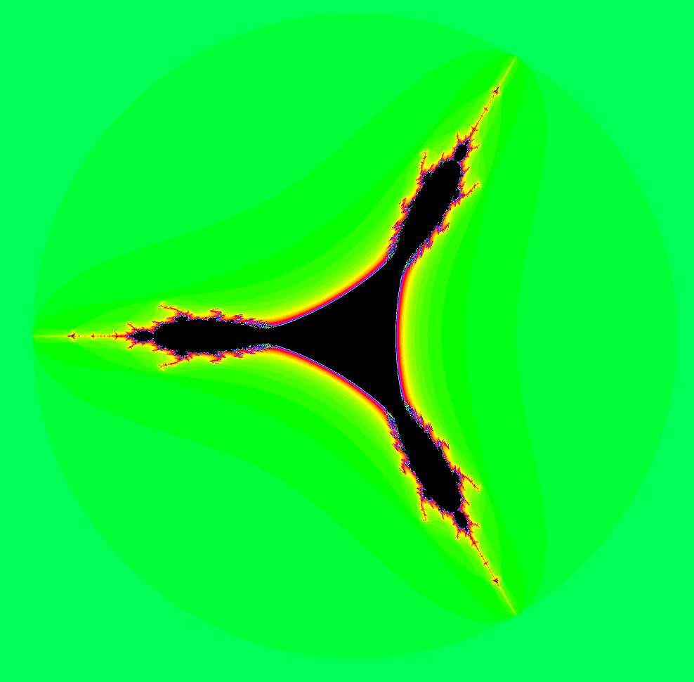
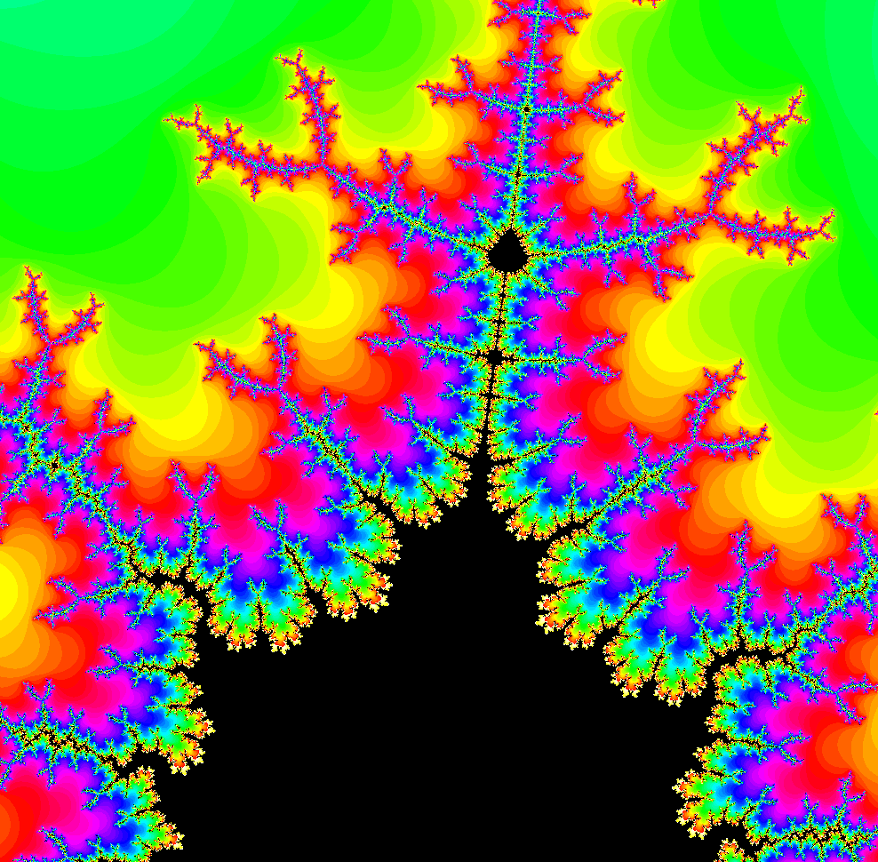

*This project has been created as part of the 42 curriculum by hsennane.*

# fract-ol

## Description

**fract-ol** is an interactive **fractal visualizer written in C** using the Linux version of **MiniLibX**. This 42 / 1337 project explores how mathematical formulas, complex numbers, color mapping, and user events work together to create interactive graphics.

The program renders a **1000 × 1000** window. You can explore the fractals by zooming, moving the view, changing the palette, and increasing the number of iterations.

The mandatory program supports **Mandelbrot** and **Julia**. The bonus program also includes **Tricorn** and zooming around the mouse cursor.

## Instructions

### Requirements

- Linux with a C compiler, GNU Make, and an X11 display.
- X11 development libraries.
- [MiniLibX for Linux](https://github.com/42Paris/minilibx-linux), which is **not included** in this repository.

On Ubuntu / Debian:

```bash
sudo apt update
sudo apt install build-essential git libx11-dev libxext-dev libbsd-dev
```

### Building the Project

Clone this repository:

```bash
git clone https://github.com/hajarsen/fractol_v_finale.git
cd fractol_v_finale
```

Clone MiniLibX in the **parent directory** and build it. The pinned MiniLibX revision below is the one documented with this source:

```bash
git clone https://github.com/42Paris/minilibx-linux.git ../minilibx-linux
git -C ../minilibx-linux checkout 6e7e6efdfed0b03e88559109319a01a521021df6
make -C ../minilibx-linux
```

Build the mandatory and bonus executables:

```bash
make INCS='-I includes -I ../minilibx-linux' \
     MLX_FLAGS='-L../minilibx-linux -lmlx -lX11 -lXext -lm'

make bonus INCS='-I includes -I ../minilibx-linux' \
     MLX_FLAGS='-L../minilibx-linux -lmlx -lX11 -lXext -lm'
```

This produces `fractol` and `fractol_bonus`. If MiniLibX is installed in standard paths, plain `make` and `make bonus` may be sufficient.

### Running the Project

**Mandatory version:**

```bash
./fractol mandelbrot
./fractol julia -0.8 0.156
```

**Bonus version:**

```bash
./fractol_bonus mandelbrot
./fractol_bonus julia 0.285 0.01
./fractol_bonus tricorn
```

Fractal names must be lowercase. Julia requires two numeric components (real and imaginary), within the range **[-2, 2]**.

### Controls

| Input | Action |
|---|---|
| Mouse wheel up | Zoom in |
| Mouse wheel down | Zoom out |
| Arrow keys | Move across the complex plane |
| Space | Shift the color palette |
| Enter | Increase the iteration count by 50 |
| Escape | Exit |
| Window close button | Exit |

**Zoom behavior:** The mandatory program zooms around the **center of the window**; the bonus program zooms around the **mouse pointer**.

### Makefile Commands

| Command | Action |
|---|---|
| `make` | Build the mandatory executable |
| `make bonus` | Build the bonus executable |
| `make clean` | Delete object files |
| `make fclean` | Delete object files and executables |
| `make re` | Rebuild the mandatory executable |

For a nonstandard MiniLibX installation, pass the same `INCS` and `MLX_FLAGS` variables to rebuilding commands.

### Project Structure

```text
fractol_v_finale/
├── includes/
│   ├── fractol.h                # Types, constants, declarations
│   └── fractol_bonus.h
├── src/
│   ├── mandatory/
│   │   ├── main.c               # Argument handling
│   │   ├── fractol.c            # Fractal calculations
│   │   ├── draw.c               # Image rendering
│   │   ├── map_pixel.c          # Pixel → complex coordinate
│   │   ├── map_to_color.c       # Iterations → RGB color
│   │   ├── events.c             # Keyboard / mouse events
│   │   └── ...                  # Initialization and utilities
│   └── bonus/
│       ├── main_bonus.c
│       ├── events_bonus.c       # Mouse-centered zoom
│       └── init_bonus.c
├── Makefile
└── README.md
```

### Manual Tests

You can check the different fractals and controls directly after compiling both programs.

| Test | Command / action | What to look for |
|---|---|---|
| Mandelbrot | `./fractol mandelbrot` | Standard Mandelbrot view |
| Julia 1 | `./fractol julia -0.8 0.156` | Julia set with thin, intricate structures |
| Julia 2 | `./fractol julia 0.285 0.01` | Different Julia pattern |
| Julia 3 | `./fractol julia -0.4 0.6` | Connected or branched Julia structure |
| Julia 4 | `./fractol julia -0.7 0.27015` | An alternative Julia pattern |
| Tricorn (bonus) | `./fractol_bonus tricorn` | Tricorn rendering from this implementation |
| Zoom | Scroll the mouse wheel | Magnification changes |
| Pan | Press arrow keys | Move around the fractal |
| Palette | Press Space | Colors change |
| Detail | Press Enter | Iteration limit increases by 50 |
| Exit | Press Esc | Window closes |

For invalid-input checks, try `./fractol`, `./fractol unknown`, and `./fractol julia 3 0`. These should exit with an error. The commands above are **suggested manual tests**, not recorded passing results.

### 📸 Screenshots and Demonstration

A gallery of Mandelbrot, Julia, and Tricorn fractals, including a closer look at the details revealed by zooming.

| Mandelbrot | Julia — view 1 |
|:---:|:---:|
|  |  |

| Julia — view 2 | Julia — view 3 |
|:---:|:---:|
|  |  |

| Tricorn (bonus) | Zoomed fractal detail |
|:---:|:---:|
|  |  |

## Resources

These are the essential mathematical and graphical concepts behind this project, with diagrams similar to the NetPractice README.

---

## 🧮 Complex Numbers

A **complex number** is made from a real component and an imaginary component:

```text
                         Imaginary axis
                               ↑
                               │
                           2i  │
                               │         ● z = 1 + i
                           1i  │         │
                               │         │
  ─────────────────────────────┼─────────┼─────────→ Real axis
                              0│         1
                               │
```

Mathematically:

```text
z = a + bi

a = real part
b = imaginary part
i² = -1

|z|² = a² + b²
```

The project stores complex numbers as two `double` values: `real` and `imag`.

### Mapping a Pixel to the Complex Plane

Every position in the window is associated with a complex number. The view width and offset decide which part of the complex plane is visible.

```text
           1000 × 1000 pixel window
    ┌─────────────────────────────────┐
    │ (0,0)                           │
    │                                 │
    │                 ● (x,y)         │
    │                                 │
    │                                 │
    │                     (999,999)   │
    └─────────────────────────────────┘
                     │
                map_pixel()
                     ▼
          z = real(x) + imag(y)·i
                     │
                     ▼
            Fractal iteration
                     │
                     ▼
              Pixel color
```

At the default zoom, the mapping covers a width of **5 units** in the complex plane, centered at an offset of (0, 0).

---

## 🌌 The Mandelbrot Set

For each pixel, the program starts with **z = 0** and treats the pixel's complex coordinate as **c**:

```text
z₀ = 0
zₙ₊₁ = zₙ² + c

Start at z = 0
      │
      ▼
  z ← z² + c
      │
      ▼
  Is |z|² ≥ 4 ?
    /      \
   yes      no
   │        │
   ▼        └─────► repeat (up to iteration limit)
  escape
```

If the point escapes before the iteration limit, it gets a color based on the escape count. If it does not escape within the limit, this implementation colors it black.

---

## ✨ The Julia Set

Julia sets use the **same recurrence** but assign the roles differently:

| | Mandelbrot | Julia |
|---|---|---|
| Initial `z` | `0` | Pixel coordinate |
| Constant `c` | Pixel coordinate | Command-line parameter |
| Recurrence | `z = z² + c` | `z = z² + c` |

### Example

```bash
./fractol julia -0.8 0.156
```

This fixes `c = -0.8 + 0.156i` and varies the starting point `z` across the pixels.

Changing the two parameters changes the Julia set's shape.

---

## 🔺 Tricorn (Bonus)

The Tricorn is based on a **conjugate quadratic map**:

```text
zₙ₊₁ = conjugate(zₙ)² + c

If z = a + bi:

conjugate(z) = a - bi
```

The implementation uses the pixel's complex coordinate for **both its initial z and c**. This differs from the commonly used canonical initialization `z₀ = 0`, so the resulting picture should be understood as the behavior of this code.

Run:

```bash
./fractol_bonus tricorn
```

---

## 🎨 Escape-Time Coloring

A fractal's appearance comes from the number of iterations needed before a point escapes.

```text
Pixel coordinate
      │
      ▼
Fractal recurrence
      │
      ▼
Escape count (0 ... iteration limit)
      │
      ├── Reached limit ───────────► Black
      │
      └── Escaped earlier
                │
                ▼
       Hue + palette shift
                │
                ▼
             RGB color
```

The **Space** key changes `color_shift`. The **Enter** key increases the iteration cap by 50, allowing additional detail at the cost of extra calculations.

---

## 🔍 Zoom and Navigation

Zooming changes the width of the visible complex-plane region.

```text
Before zoom                    After zoom
┌──────────────────────┐       ┌──────────────────────┐
│                      │       │                      │
│      ┌───────┐       │  ──►  │    ┌───────────┐     │
│      │feature│       │       │    │  feature  │     │
│      └───────┘       │       │    └───────────┘     │
│                      │       │                      │
└──────────────────────┘       └──────────────────────┘

Smaller complex-plane width = more magnification
```

In the mandatory program, zooming preserves the complex coordinate at the **window center**. The bonus code instead preserves the coordinate under the **mouse pointer**.

---

## 🖥️ MiniLibX Rendering

MiniLibX provides the window, image buffer, event hooks, and display operations.

```text
Start program
     │
     ▼
Initialize MiniLibX + window
     │
     ▼
Create image buffer
     │
     ▼
For each pixel (x,y)
     │
     ├── Map pixel → complex number
     ├── Iterate fractal formula
     └── Map escape count → RGB pixel
     │
     ▼
Display image in window
     │
     ▼
Listen for keyboard / mouse input
     │
     └── Redraw if the view changes
```

### Useful Links

- [42 MiniLibX for Linux](https://github.com/42Paris/minilibx-linux)
- [Mandelbrot set](https://en.wikipedia.org/wiki/Mandelbrot_set)
- [Julia set](https://en.wikipedia.org/wiki/Julia_set)
- [Tricorn fractal](https://en.wikipedia.org/wiki/Tricorn_(mathematics))
- [Complex numbers — Wikipedia](https://en.wikipedia.org/wiki/Complex_number)

### AI Usage

AI assistance was used to **organize the README, explain the mathematical concepts, and prepare educational diagrams**. The screenshots are not yet provided, and the application source files were not modified.
